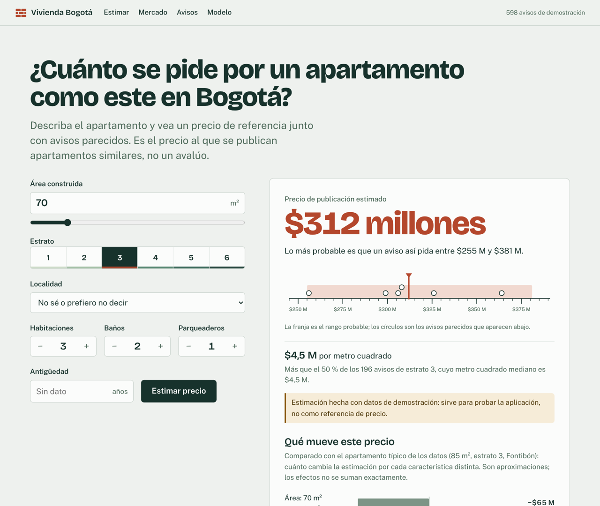

# Vivienda Bogotá: precio de apartamentos en venta

Aplicación web que estima el **precio de publicación** de un apartamento en venta en Bogotá D.C., lo compara con avisos parecidos y analiza los precios por localidad y barrio en un mapa. La recolección de avisos, su revisión semanal, la limpieza, el versionado del dataset y el reentrenamiento del modelo corren solos mientras la aplicación está abierta.

Proyecto de Electiva II, Universidad ECCI: Diego Alejandro Galicia Forero, Cristian Javier Gómez Castañeda y Camila Andrea Vanegas Ducuara.



> La estimación es una referencia del precio al que se publican apartamentos similares. **No es un avalúo comercial.**

## Qué hace

- **Precios por zona:** mapa real de Colombia, Bogotá y sus 20 localidades, coloreadas por el metro cuadrado mediano. Al elegir una localidad se ven el precio promedio y mediano, el precio por m² frente a Bogotá, el rango de precios, el valor estimado de un apartamento típico, los barrios y los avisos que están por debajo de lo esperado. Debajo, una comparación de todas las localidades.
- **Actualización automática:** al abrir la aplicación arranca un ciclo que busca avisos nuevos, revisa los ya guardados (cambios de precio, características o retiro) y, si algo cambió, construye un dataset nuevo y reentrena el modelo. La página se actualiza sola.
- **Estimar:** se describe un apartamento (área, estrato, localidad, habitaciones, baños, parqueaderos, antigüedad) y la aplicación devuelve un precio, un rango probable, el precio por metro cuadrado, qué características suben o bajan el precio y los avisos más parecidos.
- **Mercado:** un diagrama de caja del precio por m² según estrato, la relación entre área y precio, el m² mediano por localidad y un mapa de los avisos.
- **Avisos:** una tabla con filtros para revisar los datos uno por uno, con cuánto está cada aviso por encima o por debajo del precio que el modelo esperaba para él, y si su precio subió o bajó.
- **Modelo:** las métricas de validación cruzada y de la prueba final, explicadas.

## Recolector en segundo plano

La base no crece solo cuando alguien usa la aplicación. Un proceso aparte, `python -m scraper.servicio`, la alimenta todo el tiempo:

- **Arranca solo**: al abrir la app (si no está corriendo) y, en Windows, al iniciar sesión (`iniciar.bat` deja un acceso directo en la carpeta Inicio, sin permisos de administrador). Sigue trabajando aunque se cierren la página y la app; se detiene solo al apagar el computador. `quitar-recolector.bat` lo detiene y quita el inicio automático.
- **Mientras haya avisos por leer, no para**: encadena ciclos con un minuto de separación; cuando la base está al día, vuelve cada `intervalo_horas`. Respeta las mismas pausas de 4 a 8 s entre solicitudes, robots.txt y las pausas largas si el portal limita el acceso.
- **Lee primero lo que falta**: con más de 300 avisos pendientes no sigue recorriendo el listado (solo mira las primeras páginas, lo más nuevo) y dedica el tiempo a leerlos.
- **Las tarjetas del listado traen los datos**: cuando la tarjeta de un aviso trae precio, área, estrato, habitaciones y ubicación, se guarda sin abrir el aviso (unas 25 por solicitud); si le falta algo, se abre después para completarlo, sin registrarlo como un cambio.
- **La demanda manda**: si una estimación sale sin comparables o con confiabilidad baja, esa localidad pasa primero en la cola de lectura durante 72 h.
- **Las consultas no esperan al portal**: las estimaciones usan la base ya validada; el portal solo lo visita el recolector.

La sección Actualización muestra si el recolector está vivo, desde cuándo, cuántos avisos nuevos guardó y verificó en las últimas 24 h y cuánto falta, a ese ritmo, para leer los pendientes. Su registro está en `datos/registros/recolector.log`.

## Registros (logs) y diagnóstico

Todo lo que pasa queda escrito, en el servidor y en el navegador:

| Archivo | Qué tiene |
|---|---|
| `datos/registros/vivienda.log` | Cada paso: arranque, carga del dataset, entrenamiento, cada solicitud a la API con su duración, cada estimación, y los mensajes y errores del navegador (`vivienda.navegador`). Rota a los 5 MB. |
| `datos/registros/errores.log` | Solo avisos y errores, con la traza completa. Es el primero que hay que abrir. |
| `datos/estado/ciclo.log` | La recolección automática: cada página del listado, cada aviso, cada cambio de precio. Sus avisos y errores se copian también a `errores.log`. |
| `datos/registros/instalacion.log` | Lo que hizo `iniciar.bat`: instalación de librerías y copia de datos. |
| `datos/registros/diagnostico-*.txt` | Cada informe del diagnóstico. |

Cada línea lleva fecha con milisegundos, nivel, proceso, módulo, el identificador de la solicitud (`rid=`) y el archivo y la línea de código que la escribió. El `rid` es el mismo en la línea del navegador y en la del servidor, así un error en pantalla se encuentra rápido en el registro.

- **Más detalle:** `iniciar-con-detalle.bat`, o `python -m app --depurar` (o `VIVIENDA_LOG=DEBUG`). Registra además cada solicitud al portal, cada aviso descartado en la limpieza y por qué, cada llamada con sus parámetros.
- **En el navegador:** F12 > Consola muestra los mensajes con el prefijo `[vivienda]`. Abra la página con `?depurar=1` para ver cada paso (queda recordado; `?depurar=0` lo apaga).
- **Diagnóstico:** `python -m app.diagnostico` revisa Python, librerías, archivos, configuración, base de datos, dataset, modelo, puerto e internet, y dice cómo arreglar cada problema. También en la página (sección Actualización, solo desde el mismo computador): registro de errores, registro completo y diagnóstico.

## Navegadores compatibles

Funciona en las versiones publicadas desde finales de 2020 de Chrome, Edge, Firefox, Safari (Mac, iPhone y iPad), Opera y Samsung Internet, en computador, tableta y celular. La lista exacta está en `.browserslistrc`, y la integración continua revisa en cada cambio que el código no use nada que esos navegadores no entiendan. En navegadores más antiguos, como Internet Explorer, la página muestra un aviso en vez de quedar en blanco. El mapa necesita internet solo para el fondo de calles: los límites de Colombia y de las localidades vienen en el repositorio.

## Empezar en 3 minutos

Necesita Python 3.11 o superior.

**En Windows, sin escribir comandos:** descomprima el proyecto y haga doble clic en `iniciar.bat`. La primera vez crea el entorno e instala las librerías (unos minutos); después revisa que todo esté bien, copia la base `vivienda.db` del recolector anterior si la encuentra en Descargas, y abre el navegador solo. En Linux o macOS: `./iniciar.sh`.

Después, para **actualizar** a una versión nueva: descargue el zip a Descargas y haga doble clic en `actualizar.bat` (detiene el recolector, conserva `config/portales.yaml` y la carpeta `datos`, descomprime y vuelve a abrir). `iniciar.bat` deja además un ícono **Vivienda Bogotá** en el escritorio.

A mano:

```bash
git clone https://github.com/USUARIO/vivienda-bogota.git
cd vivienda-bogota
python -m venv .venv
source .venv/bin/activate          # Windows (PowerShell): .venv\Scripts\Activate.ps1
pip install -r requirements.txt
python -m app
```

Abra <http://127.0.0.1:8000>.

La primera vez, si no hay ningún dataset en `datos/`, la aplicación crea **datos sintéticos de demostración** y entrena el modelo con ellos. La interfaz lo indica con una franja amarilla. Esos datos los inventa un programa (`modelo/demo.py`) y no describen el mercado real: sirven solo para probar la aplicación.

### Con Docker

```bash
docker compose up --build
```

Y abra <http://localhost:8000>. Las carpetas `datos/` y `artefactos/` se comparten con el contenedor, así que los datasets que ponga en `datos/` los usa la aplicación.

El contenedor no corre como administrador (usuario `vivienda`, uid 10001). En Linux, si el contenedor no puede escribir en esas carpetas, deles permiso una vez: `sudo chown -R 10001 datos artefactos`.

## Actualización automática

Mientras la aplicación está abierta, un ciclo (`scraper/ciclo.py`) se ejecuta 30 segundos después de abrirla y luego cada 12 horas:

1. **Listado:** revisa las primeras páginas (ahí aparecen los avisos nuevos) y un tramo de 100 páginas más, que avanza ciclo a ciclo hasta recorrer todo el listado y vuelve a empezar.
2. **Avisos nuevos:** lee hasta 600 enlaces que nunca se han visitado. Un enlace ya conocido no se duplica.
3. **Revisión:** vuelve a visitar hasta 300 avisos guardados cuya última visita tiene más de 7 días. Si cambió el precio o una característica, actualiza el registro y guarda el cambio en la tabla `cambios`. Si el aviso ya no existe (404, 410 o redirección), lo marca como retirado: sale del dataset pero conserva su historia.
4. **Dataset y modelo:** si algo cambió, construye un corte nuevo (solo avisos disponibles) y reentrena. La aplicación lo carga sin reiniciarse.

Las reglas de cortesía son las mismas de la recolección manual: pausa de 4 a 8 segundos por solicitud, robots.txt, y alto total ante 403, 429 o captcha. Tras un bloqueo, el siguiente intento espera 6 horas (12, 24 y hasta 48 si se repite). Sin internet, reintenta en una hora.

**Antes de que empiece a recolectar** (una sola vez):

1. Una persona del equipo lee los términos de uso del portal y, si permiten la extracción, pone en `config/portales.yaml`: `terminos_revisados: true`, su nombre en `revisado_por` y la fecha en `fecha_revision`.
2. Cambie `CAMBIAR@correo.com` en `user_agent` por un correo real de contacto.

Mientras ningún portal esté autorizado, la sección "Actualización de los datos" de la página lo dice y no se visita nada.

Todo se ajusta en el bloque `automatico:` de `config/portales.yaml` (intervalo, páginas, avisos por ciclo, días entre revisiones). Para apagarlo: `activo: false`, o la variable `VIVIENDA_AUTOMATICO=0`. El avance queda en `datos/estado/ciclo.json`, el registro en `datos/estado/ciclo.log` y cada ciclo en la tabla `ejecuciones`. Un ciclo también se puede lanzar a mano con `python -m scraper.ciclo`, o con el botón "Actualizar ahora" de la página (solo desde el mismo computador).

**El ciclo trabaja solo mientras la aplicación está abierta.** Para que corra aunque nadie la abra, programe `python -m scraper.ciclo` en el Programador de tareas de Windows (o con cron en Linux).

### Traer los datos que ya recolectaron

Si ya usaban el recolector en otra carpeta, no pierdan esos enlaces y avisos:

- **Con SQLite (lo normal si no configuraron PostgreSQL):** copie `datos\vivienda.db` de la carpeta vieja a `datos\` de esta. Al abrir la aplicación, la base recibe sola las columnas nuevas.
- **Con PostgreSQL:** copie su archivo `.env` a esta carpeta.
- Copie también los campos `terminos_revisados`, `revisado_por`, `fecha_revision` y `user_agent` de su `config/portales.yaml` anterior.

## Usar datos reales

La aplicación busca el dataset en este orden:

1. la ruta en la variable `VIVIENDA_DATASET`, si está definida;
2. el corte más reciente `datos/dataset_vN.csv` que produce la limpieza;
3. los datos de demostración.

Cada vez que arranca compara la huella SHA-256 del dataset con la del último entrenamiento. Si cambió, vuelve a entrenar sola. También puede entrenar a mano:

```bash
python -m modelo.entrenar                              # usa el dataset que encuentre
python -m modelo.entrenar --dataset datos/dataset_v3.csv
```

El CSV necesita al menos las columnas `precio` y `area_m2`, y debería traer `estrato` y `localidad`. Las demás (`habitaciones`, `banos`, `parqueaderos`, `antiguedad`, `barrio`, `latitud`, `longitud`, `url_origen`) se aprovechan si existen. Es el mismo formato que produce `limpieza.construir_dataset`.

## Cómo se estima: comparables reales de cada zona

La aplicación no aplica el mismo criterio a todas las localidades. Antes de dar un precio:

1. **Muestra lo que hay en la zona** (`/api/perfil?localidad=Suba`): cuántos avisos reales hay de cada estrato, número de habitaciones, baños y parqueaderos, los tramos de área y antigüedad, precios (mediano, promedio, 80 % central), m² promedio y los tipos de apartamento más publicados. El formulario se adapta: cada botón de estrato muestra cuántos avisos hay, los que no existen en la localidad se atenúan, y bajo cada campo se ve lo común allí.
2. **Busca comparables** (`modelo/comparables.py`) de lo más estricto a lo más amplio, y se detiene en el primer paso que reúne al menos 5: misma localidad, estrato, habitaciones y área ±20 %; luego ±1 habitación y área ±35 %; luego estrato vecino; luego las localidades vecinas (calculadas de los límites de IDECA); por último toda Bogotá. De los que cumplen, usa los 15 más parecidos (área, estrato, habitaciones, baños, parqueaderos, antigüedad y localidad). No usa avisos que el portal ya retiró.
3. **Calcula y explica**: precio = m² mediano de los comparables × área; rango = la mitad central de sus precios por m². Muestra cuántos encontró y cuántos usó, cada búsqueda con su conteo, de qué localidades y barrios vienen, en qué se diferencian del apartamento consultado, el precio promedio y el m², y la confiabilidad con sus razones (**alta**: 10 o más comparables en búsqueda estricta y precios parecidos entre sí; **media**: 5 o más; **baja**: menos de 5 o solo con toda Bogotá).
4. **Si no hay comparables, no hay precio**: la aplicación dice que no tiene información suficiente en lugar de inventar un valor.

El modelo de aprendizaje automático (abajo) se muestra al lado como contraste: si da algo muy distinto de los comparables, lo dice.

## Cómo funciona el modelo

`modelo/entrenar.py` aplica la regla de decisión del proyecto:

1. Separa el 20 % de los avisos como **prueba final**, que no se usa para elegir.
2. Compara con **validación cruzada de 5 partes**:
   - la **línea base**: precio mediano del m² en la misma localidad y estrato, multiplicado por el área (si hay menos de 3 avisos en esa combinación, usa el estrato; si tampoco, la ciudad);
   - un **árbol de decisión**, un **bosque aleatorio** y un **gradient boosting**, que aprenden el logaritmo del precio.
3. Elige el de menor **MAE**. Si ningún modelo de árboles supera a la línea base, se usa la línea base y la interfaz lo dice.
4. Mide el elegido una sola vez en la prueba final: MAE, RMSE, R², error relativo (MAE dividido por el precio mediano; la meta del proyecto es 15 %) y cobertura del rango.
5. Lo vuelve a entrenar con todos los datos y lo guarda en `artefactos/modelo.joblib`, con las métricas en `artefactos/metricas.json`.

**Rango de precio.** Se calcula con predicción conformal: con los errores que el modelo comete en avisos que no vio, se busca el ancho que contiene el precio real 8 de cada 10 veces.

**Explicación.** Para cada característica que el usuario informó, se calcula cuánto cambiaría la estimación si esa característica tomara el valor del apartamento típico del dataset. Es una aproximación: los efectos no se suman exactamente.

**Por encima o por debajo de lo esperado.** Al entrenar se guarda, para cada aviso, el precio que el modelo predijo sin haberlo visto (validación cruzada). Un aviso más de 10 % por debajo de ese precio se marca "por debajo de lo esperado"; más de 10 % por encima, "por encima". Usar predicciones fuera de muestra evita que el modelo "apruebe" avisos que memorizó.

**Advertencias.** La aplicación avisa cuando un valor está fuera del rango que el modelo vio al entrenar, o cuando hay menos de 5 avisos de la localidad o del estrato elegidos.

Si tiene `mlflow` instalado, cada entrenamiento queda registrado en `mlruns/`.

## Recolectar datos reales

### Antes de extraer nada (obligatorio)

Revisión hecha el 4 de octubre de 2026:

| Portal | robots.txt | Decisión |
| --- | --- | --- |
| Finca Raíz | Permite `/venta/apartamentos/bogota/...` y los avisos individuales. Prohíbe `/venta/*-y-*`. | Utilizable si los términos de uso lo permiten |
| Ciencuadras | Permite `/inmueble/...`. Prohíbe `/search/` y `/site/`. | Utilizable si los términos de uso lo permiten |
| Metrocuadrado | **Prohíbe `/detail/` y `/metrocuadrado-results/`** | **No se extrae** (deshabilitado en la configuración) |

El robots.txt no reemplaza los términos de uso. Antes de recolectar, una persona debe leer los términos de cada portal. Si no prohíben la extracción automatizada, anota su nombre y la fecha en `config/portales.yaml` y cambia `terminos_revisados: true`. Mientras siga en `false`, el programa no se ejecuta. Ponga también un correo real de contacto en `user_agent`.

### Pasos

```bash
cp .env.example .env                                   # y cambie la clave
docker compose --profile recoleccion up -d db          # PostgreSQL (o use SQLite: ver .env.example)

python -m scraper.recolectar diagnostico --portal fincaraiz --url "<URL de un aviso>"
python -m scraper.recolectar listado --portal fincaraiz --paginas 10
python -m scraper.recolectar detalle --portal fincaraiz --max 200
python -m scraper.recolectar estado

python -m limpieza.geo descargar                       # mapa de localidades (una sola vez)
python -m limpieza.construir_dataset --notas "Corte Sprint 2"
```

Esto deja `datos/dataset_vN.csv` y `datos/reporte_calidad_vN.md`. Al reiniciar, la aplicación usa ese dataset y entrena con él.

El recolector respeta estas reglas:

- hace una pausa aleatoria de 4 a 8 segundos entre solicitudes, unos 500 avisos por hora como máximo;
- se **detiene** si el portal responde 403 o 429 o muestra un captcha, sin reintentar ni evadir el bloqueo;
- solo guarda los campos de una lista blanca y nunca lee nombres, teléfonos ni correos de anunciantes (Ley 1581 de 2012);
- excluye los avisos de `/proyectos-vivienda/`, que muestran un precio "desde" y no el de una unidad.

Antes de recolectar en volumen, pruebe con `diagnostico` sobre 2 o 3 avisos. Los portales cambian su HTML con frecuencia.

### Si un portal lo prohíbe: captura manual

Llene `carga_manual/plantilla_captura.csv` con un aviso por fila y ejecute:

```bash
python -m limpieza.cargar_manual carga_manual/plantilla_captura.csv
python -m limpieza.construir_dataset --notas "Incluye captura manual"
```

## Datos y privacidad

Los avisos recolectados **no se suben al repositorio**: `datos/` está en `.gitignore`, salvo la tabla `barrios_localidad.csv`. Cada persona que use el proyecto debe construir su propio dataset y cumplir los términos de cada portal. Antes de compartir un dataset, revise que no contenga datos personales.

## API

La documentación interactiva está en <http://127.0.0.1:8000/docs>.

| Método | Ruta | Para qué |
| --- | --- | --- |
| GET | `/api/estado` | Dataset en uso, modelo elegido y localidades válidas |
| POST | `/api/estimar` | Precio, rango, explicación y avisos parecidos |
| GET | `/api/mercado` | Datos de los gráficos del mercado |
| GET | `/api/avisos` | Avisos con filtros (`localidad`, `barrio`, `estrato`, `precio_max`, `area_min`, `comparacion`, `orden`, `pagina`) |
| GET | `/api/zonas` | Resumen por localidad: precios, m², rangos, puesto y comparación con Bogotá |
| GET | `/api/zonas/{localidad}` | Detalle de una localidad: barrios, apartamento típico y avisos por debajo de lo esperado |
| GET | `/api/automatizacion` | Estado del ciclo automático, conteos de la base y últimos ciclos |
| POST | `/api/automatizacion/ejecutar` | Lanza un ciclo ahora (solo desde el mismo computador) |
| GET | `/api/modelo` | Métricas completas del último entrenamiento |

Ejemplo:

```bash
curl -X POST http://127.0.0.1:8000/api/estimar \
  -H "Content-Type: application/json" \
  -d '{"area_m2": 70, "estrato": 4, "localidad": "Suba", "habitaciones": 3, "banos": 2, "parqueaderos": 1}'
```

## Estructura

```
app/                 API (FastAPI), orquestador del ciclo automático, diagnóstico e interfaz web
comun/registro.py    registro (logs) de todos los procesos: formato, archivos, rotación, trazas
  static/geo/        límites de Colombia (Natural Earth) y de las 20 localidades (IDECA, CC BY 4.0)
  static/vendor/     Leaflet y fuentes incluidas, para no depender de CDN
modelo/              carga del dataset, línea base, entrenamiento, estimación y datos de demostración
scraper/             recolección: robots.txt, pausas, freno ante bloqueos, extracción y ciclo automático
limpieza/            normalización, localidad por coordenadas, deduplicación, versionado
config/portales.yaml portales, URLs, pausas y control de términos de uso
sql/schema.sql       esquema de referencia en PostgreSQL
tests/               pruebas del recolector, la limpieza, el modelo, la API y el registro
iniciar.bat          instala y abre la aplicación con doble clic (Windows); iniciar.sh en Linux/macOS
```

## Operación y seguridad

- **Salud:** `GET /api/salud` responde 200 cuando el dataset y el modelo están cargados. Docker lo usa como chequeo de salud.
- **Registro:** cada solicitud a la API deja una línea con método, ruta, estado, milisegundos y un identificador (`X-Request-ID`). El nivel se cambia con `VIVIENDA_LOG=DEBUG`.
- **Cabeceras:** política de contenido (CSP) que solo permite recursos propios y las teselas del mapa, `nosniff`, bloqueo de marcos y `Referrer-Policy`.
- **Datos en la interfaz:** todo texto de los datos se escapa antes de insertarse como HTML y solo se aceptan enlaces http(s).
- **Compartir una estimación:** el formulario queda en la URL, por ejemplo `/?area=70&estrato=4&localidad=Suba`.
- **Antes de publicar en internet:** ponga la app detrás de un proxy con HTTPS y límite de solicitudes (Caddy o Nginx), y entrene fuera del arranque. El diagnóstico completo está en el documento de diagnóstico del proyecto.

## Pruebas

```bash
ruff check .      # estilo y errores probables
pytest -q         # 43 pruebas
```

GitHub Actions ejecuta las dos en cada cambio, y además construye la imagen de Docker y comprueba que arranque sana (`.github/workflows/pruebas.yml`).

## Licencia

Código bajo licencia MIT (ver `LICENSE`). Leaflet usa licencia BSD-2; las fuentes Bricolage Grotesque y Public Sans, SIL Open Font License; los límites de las localidades son de IDECA y la Secretaría Distrital de Planeación (Datos Abiertos Bogotá, CC BY 4.0), y los de los países, de Natural Earth (dominio público).
